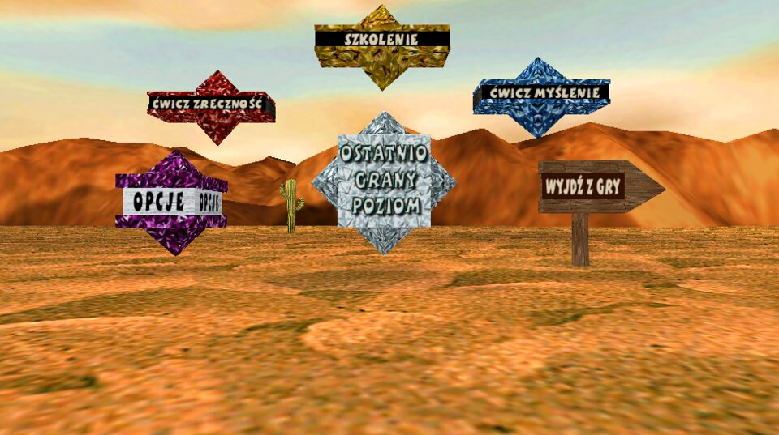
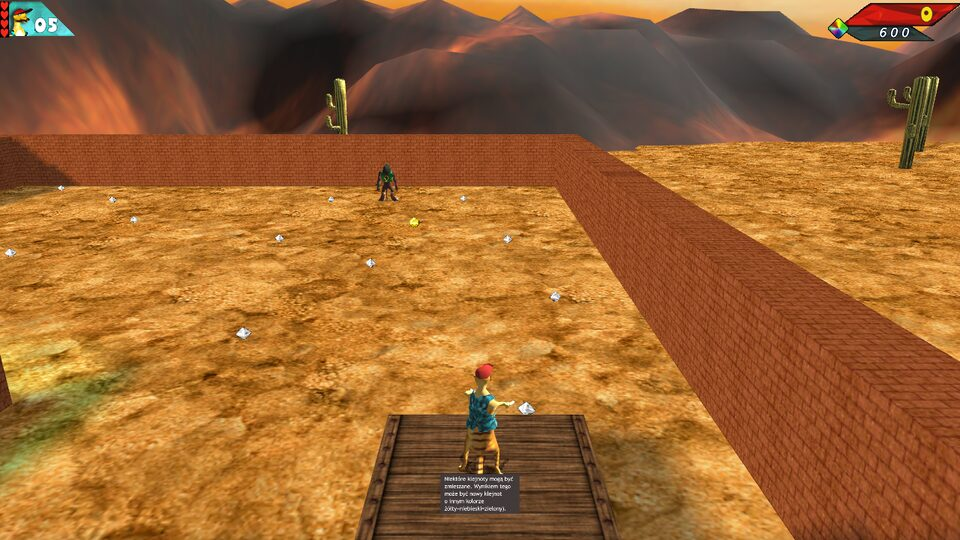
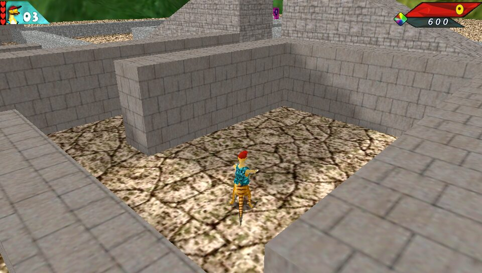
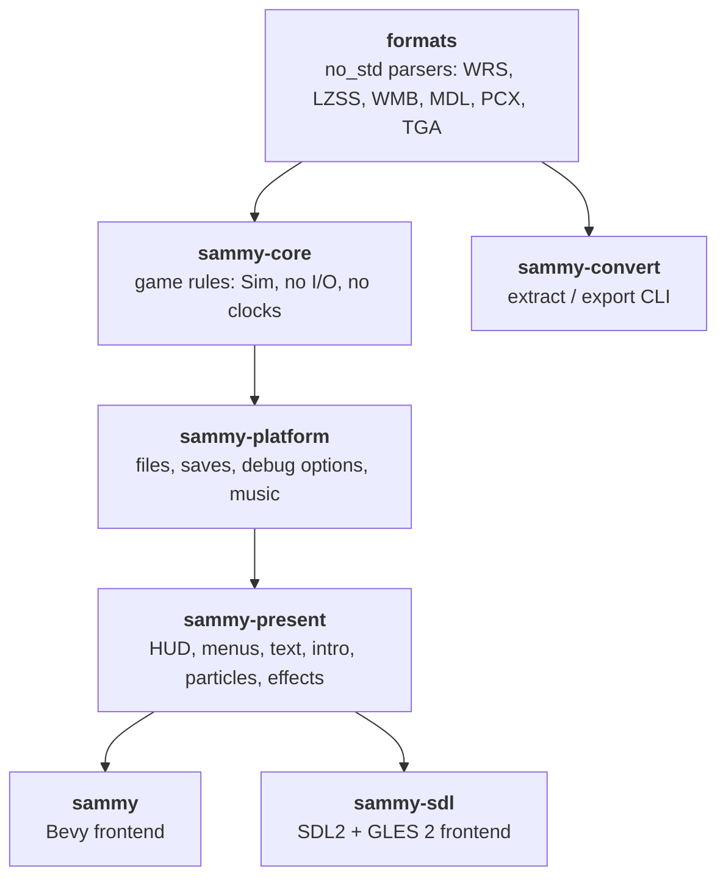

<div align="center">

# 🦎 Sammy Suricate — Rust Remake

**A faithful, reverse-engineered port of _Sammy Suricate_ (2002) to Rust.**
Bevy on the desktop, SDL2 + OpenGL ES 2 on the PS Vita and anything else.

[](https://www.rust-lang.org/)
[](https://bevyengine.org/)
[](https://www.libsdl.org/)
[](#-ps-vita)
[](#-running)
[](LICENSE)
[](#-ai-generated-code)
[](#-running)



</div>

---

> [!IMPORTANT]
> ### 🤖 AI-generated code
> **All of the code in this repository was written by AI** ([Claude](https://claude.ai), via Claude Code):
> the reverse engineering of the original formats and scripts, the documentation, the game
> rules, both frontends, the tests and the Vita packaging. A human directed the work, played
> it, reported bugs and made the decisions.

## 🎮 About

*Sammy Suricate* (2002, Rémi Valantin & Jörg Henseler) is a 3D puzzle-platformer built on
Conitec's 3D GameStudio A4/A5 engine; this port follows its Polish release. This project rebuilds it from
the original game's own files: levels (WMB), models (MDL), textures, sounds and the WDL
scripts' rules, all ported to Rust.

The remake reads **your installed copy of the original game**. No game data is stored
in this repository.

<table>
  <tr>
    <td></td>
    <td></td>
  </tr>
  <tr>
    <td align="center"><sub>Bevy frontend</sub></td>
    <td align="center"><sub>SDL / GLES 2 frontend (the one the Vita runs)</sub></td>
  </tr>
</table>

## ✨ Features

- 🧩 **The whole game**: all levels, the training, skill and thinking courses, bonus levels, intro and extro
- 🐝 Wasps, gems, doors, keys, enemies, boosts and the Eye of Truth, following the original WDL logic
- 🗺️ Original lightmapped BSP levels, animated MDL models, sky domes, particles, shadows
- 🖥️ Original menus, options, HUD (2D and 3D) and in-game help signs
- 🎵 MIDI music through a General MIDI SoundFont ([rustysynth](https://github.com/sinshu/rustysynth))
- 💾 Imports the original game's saves on first run
- 🎮 Keyboard, mouse and gamepad
- 📦 PS Vita build at 60 fps with LiveArea art

## 🏗️ Architecture

Game logic lives in one place and is shared by both frontends.



| Crate | What it does |
|---|---|
| `crates/formats` | Byte-level parsers (`wrs` archive, `lzss`, `wmb` levels, `mdl` models, `pcx`, `tga`) |
| `crates/sammy-core` | The game itself: engine-agnostic rules, deterministic `Sim` |
| `crates/sammy-platform` | The game on a machine: game files, storage, saves, the sound table, music |
| `crates/sammy-present` | How the game state looks: HUD, menus, options, text, intro, particles, extras |
| `crates/sammy` | Bevy frontend (desktop) |
| `crates/sammy-sdl` | Light SDL2 + OpenGL ES 2 frontend (PS Vita and desktops) |
| `crates/sammy-convert` | CLI: extract the archive, PCX→PNG, levels and models → `.glb` |

The reverse-engineering notes are in [`docs/`](docs): byte-level [formats](docs/formats),
[gameplay](docs/gameplay.md), [enemy AI](docs/enemy-ai.md), [level objects](docs/level-objects.md),
[menus](docs/menu.md), [HUD and saves](docs/hud-saves.md), [particles](docs/particles.md)
and the [WDL porting guide](docs/wdl-porting.md).

## 🚀 Running

You need your own copy of the original *Sammy Suricate* (the installed folder). The game
looks for it in this order:

1. `--data <folder>` on the command line, or `SAMMY_DIR`;
2. next to the executable: the game folder itself, or a `data` folder beside it (macOS
   app bundles: `Contents/Resources/data`);
3. the folder picked on an earlier run;
4. otherwise it asks with a folder dialog and remembers the choice.

```sh
cargo run --release -p sammy                     # Bevy: menu (or: -- <slot 1-49> | <file.wmb>)
cargo run --release -p sammy -- --data "/path/to/Sammy Suricate" 4
cargo run --release -p sammy-sdl                 # SDL frontend (SAMMY_LEVEL=<slot> or an argument)
cargo run --release -p sammy -- --model suricat1.mdl walkA   # model viewer
```

Saves and settings live in the per-user data folder (`~/.local/share/sammy-suricate`,
`%APPDATA%\sammy-suricate`, `~/Library/Application Support/sammy-suricate`; `SAMMY_HOME`
overrides it).

**🎵 Music** needs a General MIDI SoundFont (`.sf2`), for example
[GeneralUser GS](https://schristiancollins.com/generaluser.php). Put it next to the
executable, in the data folder or in the game folder, or point `SAMMY_SOUNDFONT` at it.

### ⌨️ Controls

| Action | Keyboard | Gamepad |
|---|---|---|
| Walk / turn | Arrows | Left stick / D-pad |
| Jump | Ctrl | A / ✕ |
| Throw a wasp | Space | X / □ |
| U-turn | Alt | B / ○ |
| Boost | Shift | Right shoulder |
| Dismiss help sign / skip | Enter | Back / Select |
| Options | Esc | Start |

## 📦 PS Vita

The `sammy-sdl` frontend runs on the PS Vita through [VitaSDK](https://vitasdk.org/) and
[cargo-vita](https://github.com/vita-rust/cargo-vita). Copy the original game folder's contents to
`ux0:data/sammy-suricate/data/`.

```sh
export VITASDK=$HOME/vitasdk PATH=$VITASDK/bin:$PATH
crates/sammy-sdl/vita/prepare.sh      # renders LiveArea art from your game data and adds the SoundFont
cd crates/sammy-sdl && cargo +nightly vita build vpk --release
# → target/armv7-sony-vita-newlibeabihf/release/sammy-sdl.vpk
```

`prepare.sh` needs ImageMagick. It builds the desktop SDL frontend, takes screenshots of
the menu and of Sammy, and turns them into the icon and LiveArea images. Its output is
not committed. The Vita logs frame timings to `ux0:data/sammy-suricate/log.txt`.

## 🛠️ Development

```sh
cargo test --release --workspace      # tests that need the game files skip themselves without them
cargo run -p sammy-convert -- extract "$SAMMY_DIR/sammypolish.wrs" extracted
cargo run -p formats --example wmbinfo -- extracted/levels/10001.wmb
```

<details>
<summary><b>Debug environment variables</b></summary>

| Variable | Effect |
|---|---|
| `SAMMY_SCREENSHOT=out.png`, `SAMMY_SHOT_SECS=2.5,4` | Save frames at those seconds, then quit |
| `SAMMY_START=x,y,z[,pan]` | Spawn point |
| `SAMMY_KEY=255`, `SAMMY_LIVES=n`, `SAMMY_HEARTS=n`, `SAMMY_AMMO=count,type`, `SAMMY_EYE=1` | Starting inventory |
| `SAMMY_AUTOWALK=1`, `SAMMY_AUTOFIRE=1` | Hold forward / fire whenever possible |
| `SAMMY_GIVE_UP=secs` | Give up the level after that long |
| `SAMMY_SKIP=action1,action2` | Leave out objects with those actions |
| `SAMMY_SEED=n` | Fixed random seed |
| `SAMMY_PORTRAIT=dist,height,angle` | Camera on Sammy's face |
| `SAMMY_NOINTRO`, `SAMMY_MENU_VIEW`, `SAMMY_MENU_CAM`, `SAMMY_OPTIONS`, `SAMMY_PAD_NAV` | Menu and options checks |
| `SAMMY_NOSAVE=1` | Don't write saves |
| `SAMMY_NOLM=1`, `SAMMY_NODUMMY=1` | Bevy: no lightmaps / hide `*dummy*` brushes |
| `SAMMY_DRAW=scene,level,sky,entities,hud` | SDL: what to draw |

</details>

## 📜 License

The code is released under the [MIT License](LICENSE).

*Sammy Suricate*, its levels, models, textures, sounds and music belong to their
original authors and are **not** covered by this license. This is an unofficial fan
project, not affiliated with the original authors or publishers. The screenshots in
`docs/img` show the original game's art for illustration only.

<div align="center">
<sub>Made with 🦀 Rust and 🤖 AI · for the meerkat</sub>
</div>
